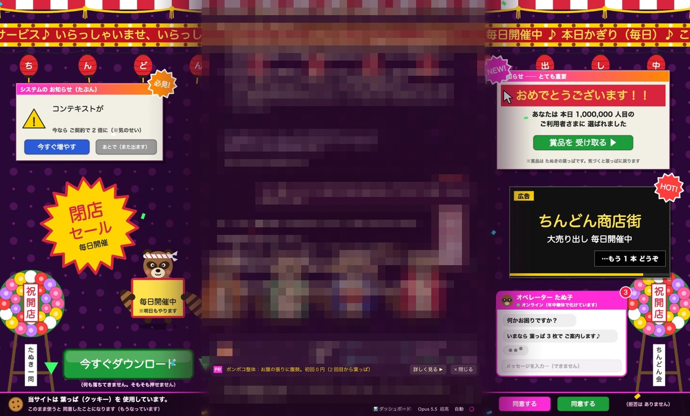
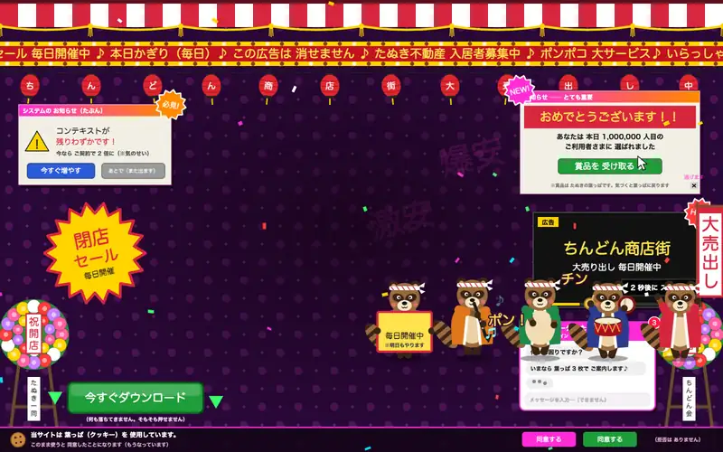
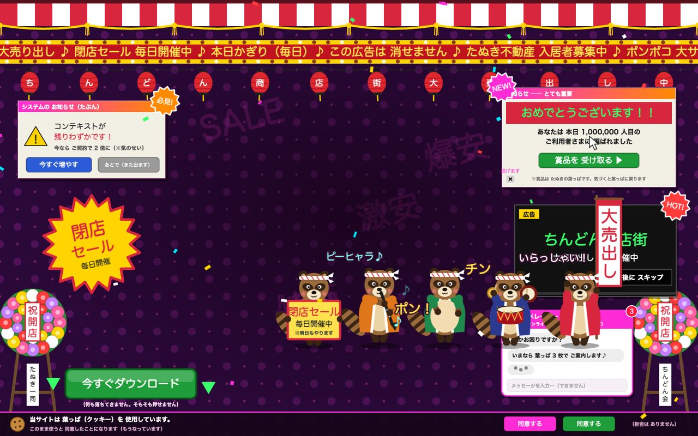
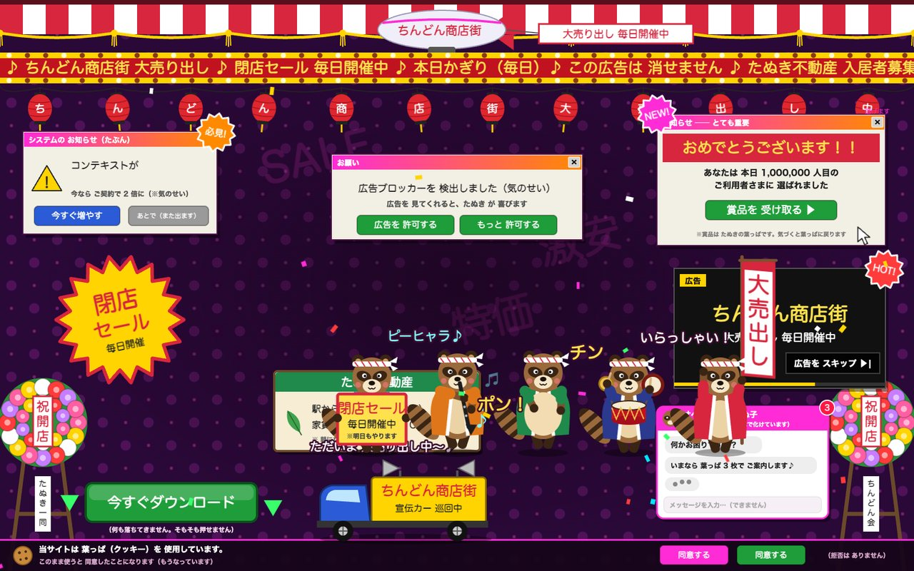
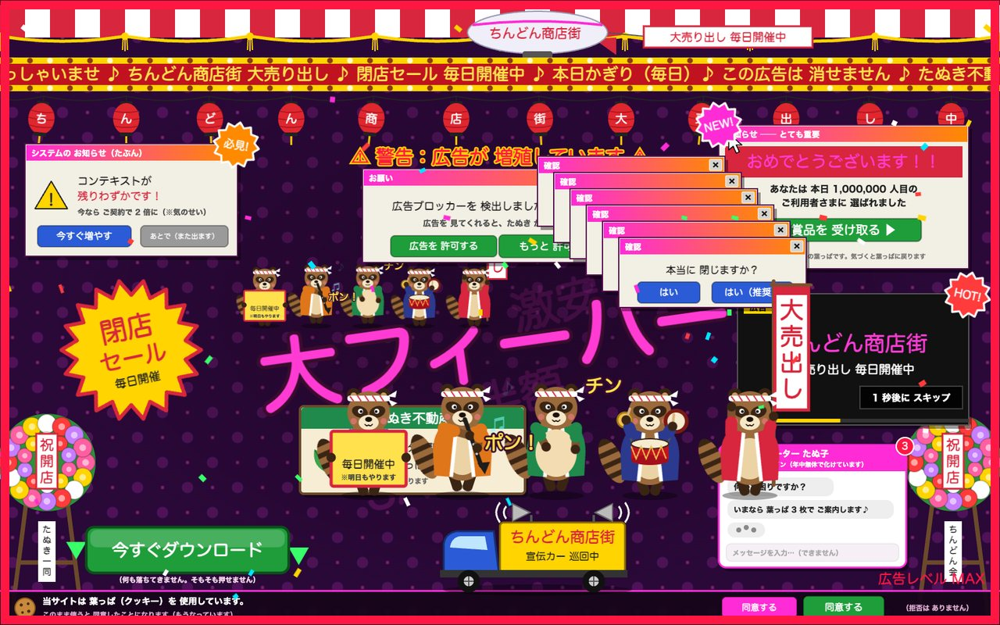

# chindon-ad

Claude Code のデスクトップアプリの会話の背景を、**わざと最悪にする** mod。たぬきのちんどん屋と、閉じられない広告。

[](https://code.claude.com/docs/en/plugins/mods/overview)
[](https://www.anthropic.com/claude)
[](./LICENSE)

<p align="center">
  
</p>

**Claude Code × Claude Opus 5.5（XHIGH）** で作りました。

会話の後ろを、はっぴ姿のたぬき 5 匹のちんどん屋が練り歩きます。そのまわりには、閉じられない広告がすき間なく並びます。入力欄の上の帯にある「× 閉じる」は、押しても閉じず、広告が増えます。送るたびに「チンドン」と鳴ります。

> [!NOTE]
> ネタの mod です。本当に消せないわけではありません。`/chindon 店じまい` と打てば、背景・帯・音・通知がすべて止まります。広告に出てくる店は、すべて架空です。

## スクリーンショット

<p align="center">
  
</p>

<table>
  <tr>
    <td width="50%"><br><sub>広告レベル 1。これがいちばん控えめです。</sub></td>
    <td width="50%"><br><sub>広告レベル 2。飛行船と宣伝カーが横切ります。</sub></td>
  </tr>
  <tr>
    <td><br><sub>広告レベル 3（MAX）。「本当に閉じますか？」が増えていきます。</sub></td>
    <td><br><sub>行列：サンドイッチマン、クラリネット（ピーヒャラ♪）、腹鼓（ポン！）、ちんどん太鼓（チン・ドン）、のぼり旗。</sub></td>
  </tr>
</table>

いちばん上の画像は、実際のアプリの画面です（中央の会話の列と入力欄の文字は、モザイクで伏せています）。動く画像とほかの画像は、mod が描く SVG をそのままブラウザで表示したものです。アプリでは、この上に半透明のパネルと会話が重なります。

## 最悪なところ

- **行列**：のぼり旗、ちんどん太鼓、腹鼓、クラリネット、サンドイッチマン（「閉店セール 毎日開催中 ※明日もやります」）。わざと 8 コマ前後のカクカクした動きで、昔の GIF 広告の手ざわりです。
- **広告**
  - 「おめでとうございます！！ あなたは本日 1,000,000 人目の…」の窓。× は、追いかけてくるマウスの矢印から逃げ回ります
  - 5 秒数えて「スキップ」が出たと思ったら「…もう 1 本どうぞ」になる動画広告
  - 「コンテキストが残りわずかです！ 今なら 2 倍に（※気のせい）」
  - 押せない「今すぐダウンロード」、入力できないオペレーター たぬ子のチャット窓
  - いちばん下のクッキーの同意バー。ボタンは「同意する」と「同意する」です
- **飾り**：紅白幕、電飾つきの電光掲示板、ゆれるちょうちん、開店祝いの花輪、降りやまない紙吹雪
- **帯**：入力欄の上に【PR】の文句が 20 秒ごとに替わって出ます。「詳しく見る ▶」は詳しくありません。**「× 閉じる」を押すと、閉じずに広告レベルが上がります**（1 → 2 → 3）
- **音と通知**：送信のたびに「チンドン」と鳴ります。ターンの終わりには、ときどき広告の通知が出ます（レベル 1 は 3 回に 1 回、レベル 3 は毎回）
- **レベルが上がると**：レベル 2 で飛行船・宣伝カー・広告ブロッカーのお願い・たぬき不動産が増えます。レベル 3 では確認の窓が増殖し、広告が震え、「大フィーバー」の文字が出て、紙吹雪が倍になり、2 組目の行列が奥を逆向きに歩きます。会話の後ろのガラスも、レベルが上がるほど薄くなります

画面全体を点滅させることはしません。点滅するのは小さな字と枠だけです。macOS の「視差効果を減らす」がオンのときは、動きが止まります。

## 使い方

入れると、何もしなくても背景が出ます。止めたり、量を変えたりするのは `/chindon` です。

| 打つもの | 起きること |
| --- | --- |
| `/chindon` | いまの状態と、このウィンドウが背景を描いているかを表示する |
| `/chindon 店じまい` | 全部止める（背景・帯・音・通知）。本当に止まります |
| `/chindon 開店` | また始める |
| `/chindon レベル 1`　`2`　`3` | 広告の量を決める（帯の × を押すと勝手に上がります） |
| `/chindon もっと` | 広告レベルを 1 つ上げる |
| `/chindon 音 あり`　`なし` | 送信のたびの「チンドン」を鳴らす・鳴らさない |

- 言葉は英語でも通じます（`off`、`on`、`level 2`、`more`、`sound off`）。
- 選んだ内容は、このマシンのすべてのセッションで共通です。ほかの開いているセッションには、次にメッセージを送ったときに反映されます。
- 背景が出ている間は、アプリを赤紫とクリーム色の配色で描きます。

## インストール

**動作環境**：Claude Code のデスクトップアプリ（Code タブ）のうち、mod の背景（テーマ）を描ける版。作者は macOS 版のデスクトップアプリ（中に入っている Claude Code は 2.1.325）で確かめました。ターミナルの `claude` や VS Code 拡張では、背景は出ません。

Claude Code のセッションの入力欄に、次の 1 行を打ちます（マーケットプレイスを足すか聞かれたら `y`、続けて入れる範囲を選びます）。

```text
/plugin install chindon-ad --marketplace tanuu5/chindon-ad
```

シェルからなら、こちらです。

```bash
claude plugin install chindon-ad --marketplace tanuu5/chindon-ad
```

入れたあと、デスクトップアプリで新しいセッションを開くと背景が出ます。外すときは `/plugin` の画面で無効にします。

### この mod がすること・しないこと

mod は Claude Code の中で、あなたの権限のまま動きます。入れる前に中身を確かめてください。

- フックするイベント：`session.start`（コマンドの登録と背景の設定）、`prompt.submit`（「チンドン」を鳴らし、ほかのセッションで選び直した内容を取り込むだけ。プロンプトの文面は読まず、変えません）、`turn.complete`（ときどき広告の通知を出す）、`command.run`（`/chindon` だけ）、`ui.render`（背景の `Backdrop` と、入力欄の上の帯の自分の行だけ）。
- 使う API：`$.theme.set()`・`$.theme.clear()`（背景と配色）、`$.store`（営業中か・広告レベル・音の有無を覚える）、`$.state`（帯の表示用の写し）、`$.audio.play()`（mod に入っている WAV を鳴らす。macOS では `afplay`）、`$.ui.toast()`（広告の通知）、`$.clock`（帯の文句を 20 秒ごとに替える）、`$.command.register()`。
- ファイルは読みません。書き込むのは Claude Code が mod ごとに用意する保存領域（`$.store`）だけです。外部のコマンドの実行も、ネットワーク通信も、モデルへの問い合わせもしません。
- セッションのテーマは 1 つだけです。ほかのテーマの mod と一緒に使うと、あとから設定したほうが勝ちます。`/chindon 店じまい` は、この mod が背景を出していたときだけ、テーマを消します。店じまいしたあとは、ほかの mod の背景をその mod のコマンドで出し直してください。

## 制作について

企画・ディレクション：**たぬ**　／　開発：**Claude Code（Claude Opus 5.5・推論レベル XHIGH）**

同じ作者の背景の mod [clawd-workroom](https://github.com/tanuu5/clawd-workroom)（Clawd の作業部屋）を作った翌日に、「いい背景を作ったので、次は最悪なものを。消せない広告とか、ちんどん屋とか」という思いつきから作りました。絵は 1 枚の SVG と CSS アニメーションだけで、画像の素材は使っていません。たぬきは 1 匹分の体を組み立てて、持ち物だけを替えています。背景は押せない作りなので、「押すと増える × 」は入力欄の上の帯のボタンで作りました。最初の版をアプリで見てもらったあと、「もっともりもりに」と言われて、会話の列の左右と上下の空きを埋めています。効果音は、Python の標準ライブラリだけで合成しました（鉦・太鼓・クラリネット風の音）。

## 更新履歴

- **2026-11-15**（v0.1.0）：公開

## 開発

```text
.claude-plugin/marketplace.json        マーケットプレイスの定義
plugins/chindon-ad/
  .claude-plugin/plugin.json           mod の定義
  hooks/hooks.json                     読み込むモジュール
  hooks/register.tsx                   本体（/chindon、帯、音と通知、背景を描くフック）
  hooks/scene.ts                       背景の SVG（行列・広告・飾り、レベル 1〜3）
  hooks/copy.ts                        帯と通知の文句
  hooks/palette-data.ts                配色のデータ（tools/make-palette.mjs が作る）
  sounds/chindon.wav, pon.wav          効果音（tools/make-sounds.py が作る）
  types/index.d.ts                     $.state に置く値の型
  tests/chindon.test.tsx               テスト
tools/
  make-palette.mjs                     配色のデータを作り直す
  make-sounds.py                       効果音を作り直す（Python の標準ライブラリだけ）
```

手元の版を直接読み込むには、`claude --plugin-dir ./plugins/chindon-ad` で起動します。起動フラグを渡せないデスクトップアプリでは、`~/.claude/settings.json` の `env` に `CLAUDE_CODE_PLUGIN_DIRS` として、このフォルダの絶対パスを書きます（反映にはセッションの開き直しが必要です）。

```bash
claude plugin validate ./plugins/chindon-ad
```

```bash
claude plugin test ./plugins/chindon-ad
```

`claude` は、デスクトップアプリと同じか新しい版のものを使ってください。古い版は背景の API を知らず、警告を出します。

配色を変えるときは `tools/make-palette.mjs` の色を直し、次のコマンドでデータを作り直します。`make-colors.js` は、Claude Code の plugin-authoring スキルのフォルダにあるファイルです（このリポジトリには入れていません）。

```bash
node tools/make-palette.mjs <make-colors.js のパス>
```

効果音を作り直すときは、こちらです。

```bash
python3 tools/make-sounds.py
```

## クレジット・ライセンス

- コード・絵・効果音：MIT License（[LICENSE](LICENSE)）© 2026 たぬ
- 配色のデータ（`hooks/palette-data.ts`）は、Claude Code の plugin-authoring スキルに入っている `make-colors.js` で作りました。色の名前は Claude のデザインシステムのものです。
- 広告に出てくる店・商品・人物は、すべて架空です。
- MIT License の対象はこのリポジトリのコードと文章です。「Claude」の名前や商標の使用を許諾するものではありません。
